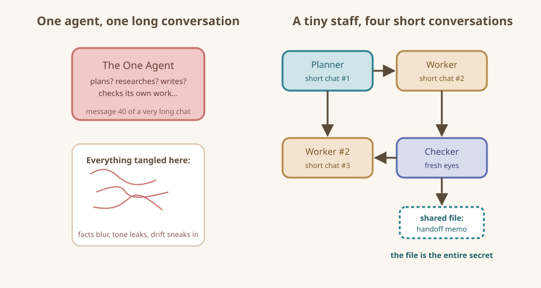

# When a Team Beats One Agent

Do you even need a band? Most songs don't.

## The honest answer first

Most tasks need exactly **one** agent. If you can describe the job in one sentence and check the answer in one minute, hire no one. A team adds coordination cost — files to pass, agendas to write, misunderstandings to fix — and coordination is a real expense even when agents work for free.

So before anything else, take the fifteen-second test below.

## The fifteen-second team test

Answer three questions with yes or no:

1. **Split?** Can the task be broken into genuinely different jobs (looking things up vs. writing vs. checking)?
2. **Two eyes?** Would a second, *independent* opinion catch expensive mistakes before you act on this?
3. **Too big?** Would one conversation with one agent get so long and tangled that either of you starts forgetting things?

- **Zero yeses:** use one agent. Done. You just saved yourself an afternoon.
- **One yes:** use one agent with a better workflow (that is what the *Agents-and-MCP Handbook* teaches).
- **Two or three yeses:** this is a team task. Keep reading.

## Why single agents struggle on certain jobs

Research ten products *and* write polished copy *and* proofread your own copy *and* keep a tidy log — that is what we keep asking one agent to do. Four failure patterns show up again and again.

### Pattern 1: The overloaded head

A long conversation fills up the agent's working memory. Old instructions slide out the back. By message forty, the agent that used to check every eBay policy link now guesses from vibes. Teams fix this not by adding intelligence but by adding **short conversations**: each agent gets a small, fresh window on the task.

### Pattern 2: The judge-jury-executioner problem

An agent that wrote the article is a poor agent to proofread it. It will defend its own sentences. Human writers know this; that is why editors exist, and why agents should have them too. A separate checker agent with a fresh conversation and a grumpy attitude is worth more than any clever prompt on a single agent.

### Pattern 3: The Swiss Army knife wobble

One agent asked to "plan, research, write, and verify" tends to blur the boundaries: the "research" leaks marketing tone, the "plan" reappears in the middle of the "writing." Separate roles force clean seams. Each agent holds one crayon — which sounds limiting, but produces straighter lines.

### Pattern 4: The stories-on-the-fly problem

Long single conversations drift: by the end, the agent is solving a subtly different task than the one you started with. A team re-anchors constantly, because each handoff is a written note that restates the goal.

## Where teams shine (and where they don't)

Teams shine when:

- The work is a **pipeline**: gather, then draft, then check, then package.
- Quality matters more than speed: you will act on the output (spend money, send an email, publish).
- You want **parallel drafts**: three agents each take a slice (ten products, three chapters, five receipts).
- The task has a natural division: facts vs. words vs. numbers.

Teams do *not* help when:

- The task is one brainstorm, one email, one question.
- The output is easy to eyeball and cheap to redo.
- You would spend more time writing handoff memos than doing the work yourself — with one agent, *your* prompt is often the fastest handoff.

## One diagram worth the whole chapter

Left side: one agent, one long conversation, four jobs at once, memory fraying at the edges. Right side: the same job chopped into short conversations, each with a fresh agent, connected by files. Notice the file in the middle of the right-hand diagram — that is the entire secret, and it gets its own chapter.

## The formation we use in this book: Planner, Workers, Checker

Almost every project in this guide uses the same tiny staff:

- **Planner** — splits your goal into jobs and writes the kickoff memo.
- **Workers** — each does one kind of work and leaves a draft in the shared folder.
- **Checker** — reads the drafts with fresh eyes and either approves or bounces them back.

You can run this in a web chat by opening separate conversations ("planner chat," "worker chat," "checker chat"). You can run it in agentic tools by creating subagents. The plumbing does not matter yet; the *shape* is what you are learning.

## A worked taste, in three sentences

You want to sell five guitar pedals on eBay. One agent tried it once and produced confident, half-tangled listings. Under the team approach, the **planner** writes a one-page memo naming the five items; a **researcher** files one fact sheet per pedal; a **writer** turns each fact sheet into a listing; a **checker** verifies every listing against its fact sheet before you publish. Same tools, same free chat windows — the difference is choreography.

## Recap card

- Run the fifteen-second test: Split? Two eyes? Too big?
- Two or more yeses = team. Zero = single agent.
- Team problems are mostly memory problems; short conversations and files are the fix.
- Default formation: Planner, Workers, Checker.
