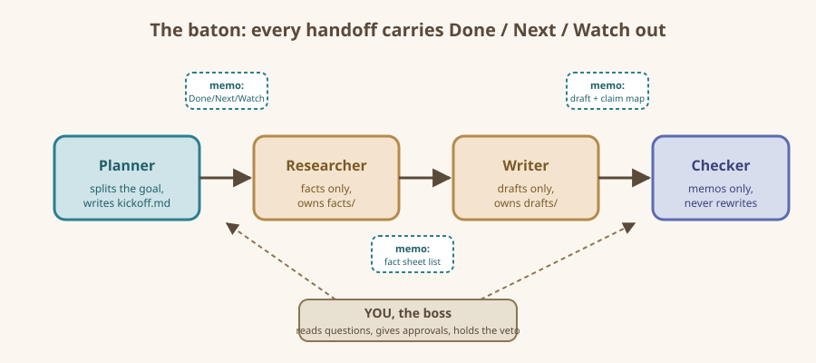

# Roles and Handoffs

One job each, and a proper note when the baton changes hands.

## The one-job rule

Every agent gets **one role, one input, one output**. Not one *goal* — one *role*. "Help with the book launch" is a goal. "Write three social-media post drafts from the fact sheet" is a role. The tighter you define the role, the less your agents wander and the less you chase them.

A useful job description fits the top of a single index card:

- **Who am I?** (the checker. fresh eyes, skeptical.)
- **What do I receive?** (draft files in the drafts folder)
- **What do I produce?** (a review memo: approved, or a punch-list of fixes)
- **What do I never do?** (I do not rewrite the draft myself)

That last line matters more than beginners expect. The checker that "helpfully rewrites" destroys the one thing it exists to provide: an outside opinion.

## The standard roster

| Role | One-line job | Typical output |
| :--- | :--- | :--- |
| Planner | Split the goal into small jobs; write the kickoff memo | kickoff.md |
| Researcher | Collect facts, only facts, from named sources | fact sheets |
| Writer | Turn fact sheets into polished drafts | draft files |
| Checker | Compare drafts against facts; approve or bounce back | review memo |
| Recorder | Keep the log of who did what and what was decided | log.md |

You will rarely need all five. Most projects in this book use three: one Planner, one or two Workers, one Checker. The Recorder role is just an agent who keeps a tidy log — a real timesaver on jobs that run more than a day.

## Why roles must "own a file"

In a real office, a person owns a desk, a drawer, a specific report. Agents work the same way: a role is not fully defined until it owns a particular file. The Researcher owns the fact sheet. The Writer owns the draft. Nobody else edits those files — they leave notes instead. This rule, called **one writer per file**, prevents the classic disaster of two agents "improving" the same draft at the same time until it contradicts itself. It is covered hands-on in the next chapter.

## The handoff memo

A handoff is not "here, take the folder." A handoff is a short note with three sections. Copy this shape every single time:

- **Done** — what I did, in two sentences, with file names.
- **Next** — what you are asked to do with it, in one sentence.
- **Watch out** — anything uncertain, missing, or of which you are suspicious.

Here is a real-shaped example from a later project:

- **Done:** Researched all five guitar pedals (fact sheets in `facts/pedal-01.md` through `facts/pedal-05.md`). Three have verifiable specs from manufacturer pages; two do not.
- **Next:** Writer, draft eBay listings for all five, one per file, using only the fact-sheet fields.
- **Watch out:** Pedals 2 and 4 have no listed weights. Mark unknown as "not stated," do not guess.

Notice what the memo does *not* contain: small talk, history, or the researcher's feelings. Past conversation never rides along; only the note does. That is deliberate. Agents cannot remember your last chat anyway — the memo is the team's working memory.

## Handoffs between agent types

The shape above works no matter what tools you use to "hire" agents:

- **Web chats:** open a chat per role. Paste the handoff memo as the first message, together with the file contents. It feels manual because it is — and that is fine, because you stay the boss.
- **Agentic coding tools** (opencode, Claude Code, Copilot-style assistants): many can define subagents with roles, so the same memo becomes the role description plus a task message.
- **MCP-connected agents** (see the companion handbook): the agents can read the shared folder themselves; your memo only needs to name the files.

## Kickoff: the first memo, written by you

Before any agent does anything, *you* write the kickoff — or have your Planner agent draft it for your approval. Keep it to five lines:

- **Goal:** one sentence, plain.
- **Definition of done:** what existence of success looks like (e.g., "five listings, each checked against its fact sheet, my thumbs-up").
- **Roster:** names of the roles and who fills them (chat window 2 = researcher, etc.).
- **Folder:** where the shared files live.
- **Rule of the house:** one writer per file; checkers never rewrite; when in doubt, stop and write a note to the boss (you).

The "when in doubt, stop and note the boss" line is your steering wheel. Teams never guess silently: they stop and annotate. Reward that behavior by reading and answering the notes.

## The baton diagram

## Common beginner mistakes

- **Rubber-stamping:** skipping review "because it's only a draft." Drafts are where agents plant the errors they expect you to catch later; review the drafts *more*, not less.
- **Role soup:** assigning one agent "plan + research + write + check." Split it, even if it costs you three chat windows.
- **Memo amnesia:** forgetting the *Watch out* section. That section is what saves your weekends; the *Done* section is flattery you can skim.
- **Meeting by voice:** discussing the work verbally with one agent in one conversation, then expecting another agent to "just know it." If it is not in the folder, it did not happen.

## Recap card

- One agent = one role, one input, one output.
- Every role owns a file; only the owner writes it.
- Every handoff = Done / Next / Watch out.
- You are always the boss; agents escalate by stopping and writing you a note.
