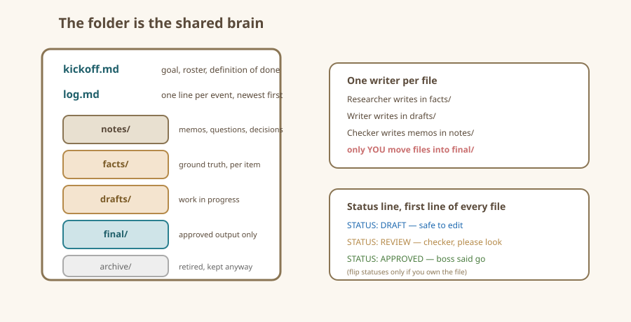

# Shared-File Conventions

The folder is the office. Give it a floor plan.

## Everything the team knows lives in files

Agents have no lasting memory between conversations. Your folder is the only shared brain. If an instruction, fact, or decision is not written down in the folder, it does not exist — no matter how sure you felt when you said it out loud.

So treat the folder like a real small-business filing system: boring, obvious, and impossible to misread. Boring is a feature.

## A starter floor plan

Every project folder in this book uses the same layout:

```
project-folder/
  kickoff.md          <- the brief: goal, roster, definition of done
  log.md              <- one line per event, newest at the top
  notes/              <- memos between agents (handoffs live here)
  facts/              <- raw research, one file per item
  drafts/             <- work in progress, one file per deliverable
  final/              <- approved outputs only
  archive/            <- anything superseded, don't delete, don't read again
```

Seven names, memorized in one read. Two rules glue it together: **facts only in facts/**, **finished only in final/**. Most "the team is confused" moments happen because a draft wandered into the wrong room and someone cited it.

## File naming: the three-part habit

Name every working file `who-what-when` — or at minimum keep these three habits:

- **Date first, in a sorting order that works:** `2026-03-01` sorts correctly everywhere, unlike `March 1st` or `0301`.
- **One thing per file:** `pedal-02-facts.md`, never `research-stuff.md`. When a file needs "stuff" in the name, it needs to be three files.
- **Status in the name when it matters:** `pedal-02-listing-DRAFT.md` vs `pedal-02-listing-FINAL.md` — when the wrong copy being picked up would be costly, put the status right there rather than inside the file.

Keep names lowercase, use dashes not spaces, and never retype a name — copy the last one and edit it, so versions stay beside their relatives.

## One writer per file, in practice

The rule from the roles chapter becomes mechanical here:

- The Researcher edits files in `facts/`.
- The Writer edits files in `drafts/`.
- The Checker writes memos in `notes/` — bounces a review, never edits a draft directly.
- You (and only you) edit `kickoff.md` and move files into `final/`.

Nobody "helpfully tidies" someone else's room. If the Writer thinks a fact sheet is wrong, the Writer writes a note in `notes/questions-to-researcher.md`; the Researcher answers there. This slightly slower loop is what keeps the team from arguing with itself in the same file.

## Status markers inside files

Open a shared file and its first line should be honest:

- `STATUS: DRAFT — writer, safe to edit`
- `STATUS: REVIEW — checker, please look`
- `STATUS: APPROVED — boss approved, move to final/`
- `STATUS: QUESTION — parked, see note at the bottom`

When an agent finishes, it flips the status. When you approve, you flip it again. It sounds silly-simple and it works, because it gives every conversation — even a fresh one with zero memory — an instant answer to "what's the story with this file?"

## The log: one line per event

`log.md` is a team diary where each event is a single dated line, newest first:

```
2026-03-01 14:20 BOSS  kickoff approved, team started
2026-03-01 14:35 RESEARCHER  fact sheets 1,2,4 done; 3,5 need source check
2026-03-01 14:41 WRITER  left question about pedal-03 weight in notes/
2026-03-01 14:50 CHECKER  bounced pedal-02 list: claims weight "450g", facts say "unstated"
```

Why a log? Because when something smells wrong later, the log is the X-ray. You can see who wrote what when, with almost zero effort. Tell each agent: *append one line here whenever you finish a task.* Agents are excellent at this discipline; you will be grateful you had them do it.

## The decision log (for anything worth an argument)

Bigger or riskier calls (price changes, policies, anything involving money or other people) get a second, shorter file: `notes/decisions.md`, with one entry per decision:

- **Date and boss:** 2026-03-01, BOSS.
- **Decision:** reserve pedals at $89, not $79.
- **Because:** comps averaged $92, three sat unsold at $79 on a rival shelf.

You never need to re-litigate an old choice or remember why; agents that read the file stop re-suggesting the abandoned idea every conversation.

## The floor plan, drawn



## What NOT to store

- Passwords, account numbers, real IDs, or patient details — nowhere, ever.
- Your clients' or family members' personal data — use initials or fictional stand-ins while learning.
- Anything you would not hand to a stranger holding a photo of it — one day you might publish this folder as a template; keep it publishable from day one.

## Recap card

- Folder = shared brain; if it isn't in the folder, it isn't real.
- Standard rooms: kickoff, log, notes, facts, drafts, final, archive.
- Name files `date-thing-status`; one thing per file.
- One writer per file; everyone else leaves notes.
- Flip status lines; keep a one-line-per-event log; log decisions that matter.
